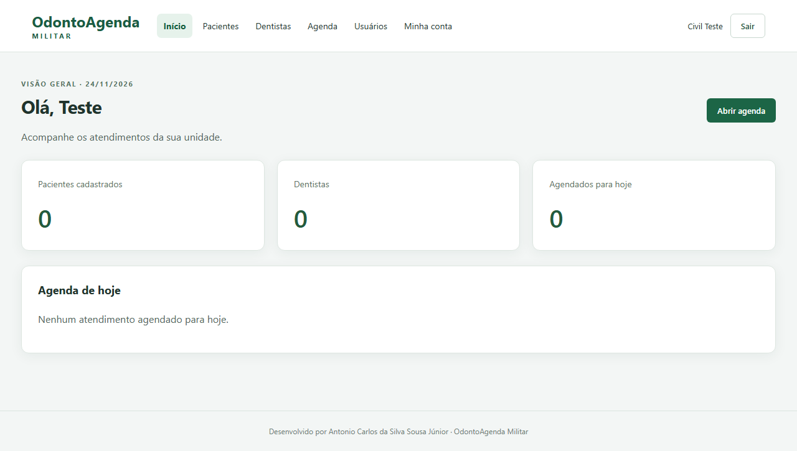

# OdontoAgenda Militar

Sistema de gestão de agendamentos odontológicos para unidades militares. Interface em português, cadastro de pacientes e dentistas, agenda com verificação de conflitos e controle de acesso por perfil.

## Interface

Capturas de demonstração com dados fictícios.



[Ver login](docs/screenshots/login.png) · [Ver versão para celular](docs/screenshots/mobile.png)

## Funcionalidades

- Login com CPF e senha, sessão de oito horas e alteração da própria senha.
- Cadastro, busca e edição de pacientes: identificação, OM, contato e nascimento.
- Cadastro de dentistas com CRO e especialidade.
- Agendamento com duração de 5 a 240 minutos, edição, observações e status.
- Verificação de sobreposição para paciente e dentista, inclusive em reservas simultâneas. Intervalos adjacentes são permitidos; atendimentos cancelados liberam o horário.
- Painel com totais e atendimentos do dia; filtros por data e dentista.
- Administração de usuários, perfis e ativação de acesso.
- Cadastros vinculados a atendimentos não podem ser excluídos, preservando o histórico.

## Executar com Docker

Requisitos: Docker com Compose v2. Para desenvolver fora dos containers, Node.js 22.12+ e MySQL.

1. Na raiz do projeto, copie o arquivo de exemplo:

   ```powershell
   Copy-Item .env.example .env
   ```

2. Edite o `.env` e preencha as senhas do banco, `JWT_SECRET` e todos os campos `ADMIN_*`. Use um CPF com dígitos verificadores válidos. A senha do administrador deve ter pelo menos 12 caracteres e até 72 bytes. Os dados iniciais não são publicados no repositório.

   Para gerar um segredo aleatório, execute `node -e "console.log(require('crypto').randomBytes(48).toString('hex'))"`. Gere valores diferentes para cada senha e segredo.

3. Inicie os serviços:

   ```powershell
   docker compose up -d --build
   docker compose ps
   ```

4. Abra **http://localhost:8080** e entre com o CPF e a senha definidos no `.env`.

O serviço `setup` cria as tabelas ausentes e o primeiro administrador. Ele termina com código zero quando a configuração foi concluída. A API só inicia depois dessa etapa e o frontend aguarda a API ficar saudável. MySQL e API ficam na rede interna; somente o frontend é publicado, na interface local da máquina.

Se a porta 8080 estiver ocupada, altere `WEB_PORT` no `.env`. O endereço da API no navegador é `/api`, servido pelo proxy Nginx.

Para acompanhar problemas: `docker compose logs --tail=100 setup backend frontend`.

Para parar: `docker compose down`. Os dados permanecem no volume. Não use `down --volumes` na instalação com dados que deseja preservar.

## Instalações antigas

A inicialização não usa `force` nem `alter` e não migra automaticamente tabelas de versões anteriores. Antes de atualizar uma instalação com dados, faça e valide um backup, confira a versão do MySQL usada no volume e planeje a adaptação do esquema. Não conecte uma imagem de outra versão do MySQL a um volume existente sem verificar compatibilidade. Os testes abaixo usam outro projeto Docker e banco descartável.

## Desenvolver localmente

Com MySQL disponível, crie um banco e um usuário exclusivo para a aplicação. Copie o `.env` da raiz para `backend/.env`, ajuste `DB_HOST=127.0.0.1`, `DB_PORT` e as credenciais do seu MySQL. Depois execute em terminais separados:

```powershell
cd backend
npm ci
npm run db:setup
npm run dev
```

```powershell
cd frontend
npm ci
npm run dev
```

Acesse **http://localhost:3000**. O Vite encaminha `/api` para `http://127.0.0.1:5000`. Para outro destino, ajuste o proxy em `frontend/vite.config.js`. Em builds com API externa, configure `VITE_API_URL` antes do build e ajuste `CORS_ORIGIN` no backend. Nunca inclua segredos nas variáveis do frontend.

## Permissões

| Operação | Administrador | Recepcionista | Dentista |
| --- | --- | --- | --- |
| Consultar pacientes, dentistas e agenda | Sim | Sim | Sim |
| Criar e editar pacientes | Sim | Sim | Não |
| Gerenciar dentistas | Sim | Não | Não |
| Criar e remarcar agendamentos | Sim | Sim | Não |
| Atualizar status e observações | Sim | Sim | Sim |
| Excluir registros | Sim | Não | Não |
| Gerenciar usuários e perfis | Sim | Não | Não |
| Alterar a própria senha | Sim | Sim | Sim |

O cadastro profissional de dentista e a conta com perfil dentista são independentes nesta versão. Todos os profissionais autenticados podem consultar a agenda da unidade; não há isolamento por dentista ou por organização militar.

## Testes e build

Testes das regras de CPF, duração e sobreposição:

```powershell
cd backend
npm ci
npm test
```

Integração real com MySQL, incluindo login, permissões, cadastros, atualização, cancelamento e concorrência:

```powershell
docker compose -p odontoagenda-validation -f compose.test.yml up --build --abort-on-container-exit --exit-code-from tests
docker compose -p odontoagenda-validation -f compose.test.yml down --volumes
```

A suíte exige `NODE_ENV=test` e um banco terminado em `_test`. A configuração de teste não monta o volume da aplicação.

Build da interface: `cd frontend`, `npm ci` e `npm run build`. O resultado fica em `frontend/build`. O GitHub Actions executa testes, build e integração em cada push ou pull request.

## Estrutura

- `backend/src`: API Express, modelos Sequelize e autorização.
- `backend/test`: testes unitários e integração HTTP com MySQL.
- `frontend/src`: interface React e cliente da API.
- `docker-compose.yml`: instalação com banco persistente e Nginx.
- `compose.test.yml`: banco isolado e testes de integração.
- `.github/workflows/ci.yml`: validação automática.

## Publicação e operação

O repositório contém o código; a instalação é feita separadamente. Antes de usar dados reais, configure domínio e HTTPS no proxy de entrada, backups com restauração verificada e acesso restrito à equipe. Nesta versão não há recuperação de senha por e-mail, prontuário, anexos, trilha completa de auditoria nem múltiplas unidades isoladas. O limitador de login é mantido na memória de uma instância; instalações com várias réplicas precisam de um limitador compartilhado.

Confira [a API](docs/API.md), [a validação](docs/VALIDACAO.md) e [o guia para publicar no GitHub](docs/PUBLICAR.md).

## Autor e licença

Antonio Carlos da Silva Sousa Júnior. Código sob licença MIT, disponível em `LICENSE`.

## Testes de navegador

Na pasta frontend, execute npm ci, npx playwright install chromium e npm run test:ui. Os testes iniciam o Vite e simulam as respostas da API para verificar login, navegação, formulários e visibilidade dos recursos por perfil. A integração com o banco real é verificada separadamente pela suíte Docker.
